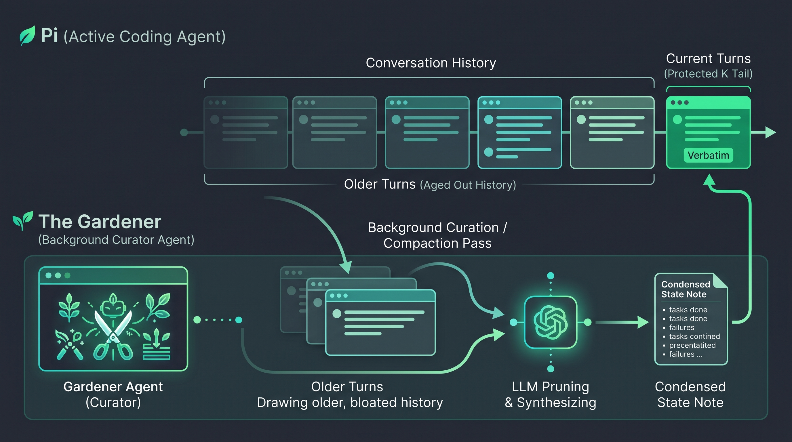

# 🌿 Gardener

**Turn-based context compaction extension for [pi](https://github.com/earendil-works/pi)**

Gardener is a context management extension for the `pi` coding agent (`@earendil-works/pi-coding-agent`). Instead of letting conversation context balloon until hitting token thresholds or context overflow, Gardener continuously prunes older history into a compact, factual state note while keeping the most recent turns untouched.

The goal is to match 'human like' information discarding.  When a person is looking through a file for something and does not find it, they dismiss the file and simply remember their target wasn't there.  An LLM will have that file permanently stuck in the context window.  

This avoids that by running a parallel agent that constantly prunes the context to remove boilerplate, summarize conclusions and failures, while preserving essential information for the task.  

This isn't so different from the standard compaction routine that many coding agents use, except instead of running in bulk when the model is near capacity, it runs every couple of turns. (default 3)  The idea is that the gardening agent, or curator can focus on keeping what is important to solve the task at hand, rather than have to figure out what to keep in one pass of a full context window.  

There is also the added benefit of the agent operating without a full context window, which can stress attention, and slow down the output.  

Surprisingly, this doesn't carry a token cost penalty as you would assume either.  Initial tests show a slight savings is total tokens used.  

---

## 💡 Why Gardener?

In long coding sessions, conversation context quickly accumulates noise:

* Multi-page tool outputs and logs.
* Failed search attempts and discarded exploration paths.
* Boilerplate code that can easily be regenerated.

Default agent compactions usually wait until a hard token cliff (e.g. 100k+ tokens or overflow recovery), triggering a massive truncation pass. 

**Gardener takes a continuous approach:**

* **Rolling window:** Keeps the last $K$ turns (default 5) completely untouched.
* **Factual extraction:** As older turns age out of the protected window, they are summarized into high-signal conclusions (e.g. *"checked records.db — only contains expense summaries"* or *"added health check endpoint to server.py"*).
* **Iterative merging:** Each pass only summarizes newly aged-out turns and merges them into the previous state note, keeping compaction latency and token usage bounded ($O(1)$ per pass).
* **Consistent model alignment:** The gardener pass uses the session's active model, ensuring the summarizer follows the same reasoning style and capability as the main agent.
* **Unified `/compact` handling:** Intercepts manual `/compact` commands, context threshold warnings, and overflow recovery to apply the same structured gardener routine.

This should allow logical continuation of long running tasks without exhausting context limits, and in theory should improve reasoning as the model should never into a state of excessive context.  

---

## 🔍 How It Works




1. **Planning:** At each boundary after every $N$ turns, Gardener checks if turns have aged out past the protected tail ($K$).
2. **Compaction Draft:** The aged-out turns and previous summary are sent to the model with preservation guidelines. The resulting summary is committed to Pi as a canonical `compaction` boundary entry.
3. **Context Refresh:** Pi replays the compaction summary followed by the kept entries for subsequent agent turns.

----------

[Initial test results](https://github.com/pxp888/memento/blob/main/testing.md)

-----------

## 🚀 Installation

### Project-level (automatic discovery)

Place the extension in your project's `.pi` configuration directory:

```bash
mkdir -p .pi/extensions/gardener
cp index.ts .pi/extensions/gardener/index.ts
```

*(Note: Your project workspace must be trusted by pi).*

### Global extension

To enable Gardener across all sessions:

```bash
mkdir -p ~/.pi/agent/extensions/gardener
cp index.ts ~/.pi/agent/extensions/gardener/index.ts
```

---

## 🌐 Mode 2: Universal FastAPI Proxy (Any Frontend or Harness)

Gardener is also available as a standalone OpenAI API-compatible reverse proxy. It sits between **any** frontend, UI, or coding agent harness (Open WebUI, LibreChat, Cline, Continue, TypingMind, custom scripts) and an upstream provider (OpenAI, OpenRouter, Ollama, vLLM, etc.).

```
Frontend (Open WebUI / Cline / Custom)
        │  POST /v1/chat/completions (full history)
        ▼
┌────────────────────────────────────────────────────────┐
│ 🌿 Gardener Proxy (http://127.0.0.1:8012)              │
│                                                        │
│ 1. Tracks turns per session                            │
│ 2. When turns age out past protected tail (K):         │
│    Runs gardener model to summarize older turns        │
│ 3. Rewrites messages payload:                          │
│    [System Prompt] + [<gardener-state>] + [Tail]       │
│ 4. Forwards to upstream (supports SSE streaming)       │
└────────────────────────────────────────────────────────┘
        │
        ▼
Upstream Provider (OpenAI / OpenRouter / Ollama / etc.)
```

### 1. Setup & Installation

Set up the virtual environment and install dependencies:

```bash
python3 -m venv venv
./venv/bin/pip install -e .
```

### 2. Configuration (`config.yaml`)

Edit `config.yaml` (or copy from `config.example.yaml`):

```yaml
server:
  host: "127.0.0.1"
  port: 8012

upstream:
  base_url: "https://api.openai.com/v1"
  api_key: ""  # Or set via OPENAI_API_KEY environment variable

gardener:
  model: ""           # If empty, mirrors the model requested by the client
  turns: 3            # Garden every N turns
  protected_turns: 5  # Keep last K assistant turns untouched
  min_tokens_to_garden: 100
  state_injection_mode: "system"  # "system" or "user_assistant"
```

### 3. Running the Proxy

Start the server using the CLI:

```bash
./venv/bin/gardener
```

Or configure on the fly via CLI options:

```bash
./venv/bin/gardener --port 8012 --upstream https://api.openai.com/v1 --turns 3 --protected-turns 5
```

### 4. Connect Your Client

Point any OpenAI-compatible client or frontend to the proxy:

```bash
export OPENAI_BASE_URL="http://127.0.0.1:8012/v1"
```

---

## ⚙️ Configuration Reference

### Proxy CLI Flags & Config Options

| Setting / Flag | CLI Option | Default | Description |
|:-------------- |:----------:|:-------:|:----------- |
| `server.port` | `-p`, `--port` | `8012` | Port the proxy listens on. |
| `server.host` | `-H`, `--host` | `127.0.0.1` | Host address to bind to. |
| `upstream.base_url` | `-u`, `--upstream` | `https://api.openai.com/v1` | Upstream OpenAI-compatible API base URL. |
| `gardener.model` | `-m`, `--model` | `""` (mirror) | Model used for compaction. If empty, mirrors requested model. |
| `gardener.turns` | `-n`, `--turns` | `3` | Frequency: garden every $N$ turns. |
| `gardener.protected_turns` | `-k`, `--protected-turns` | `5` | Number of recent assistant turns to keep verbatim. |

### Pi Extension Environment Variables

| Variable                      | Default | Description                                                                                                                       |
|:----------------------------- |:-------:|:--------------------------------------------------------------------------------------------------------------------------------- |
| `PI_GARDENER_TURNS`           | `3`     | Garden every $N$ completed turns. Set to `0` to disable automatic periodic gardening (manual `/compact` will still use Gardener). |
| `PI_GARDENER_PROTECTED_TURNS` | `5`     | Number of recent assistant turns to keep verbatim.                                                                                |

### Tuning Tips

* **API Providers & Prompt Caching:**  
  If you are using providers with prefix caching (Claude, OpenAI, Gemini), running every turn (`turns=1`) constantly alters the prompt prefix. Setting `turns=3` or `5` preserves prompt cache hits across intermediate turns.
* **Local Models & `llama.cpp`:**  
  For local models (e.g. `qwen3.8:27b`), setting `turns=3` avoids waiting for local generation after every single step.

---

## 📝 Customizing the Prompt

All persona instructions, preservation criteria, and operational rules are centralized in:
* **Proxy:** `GARDENER_PROMPT` inside `gardener/prompt.py`
* **Pi Extension:** `GARDENER_PROMPT` inside `.pi/extensions/gardener/index.ts`

You can modify preservation priorities or adjust operational rules (formatting constraints, thinking/reasoning guidelines) directly in those files.

---
