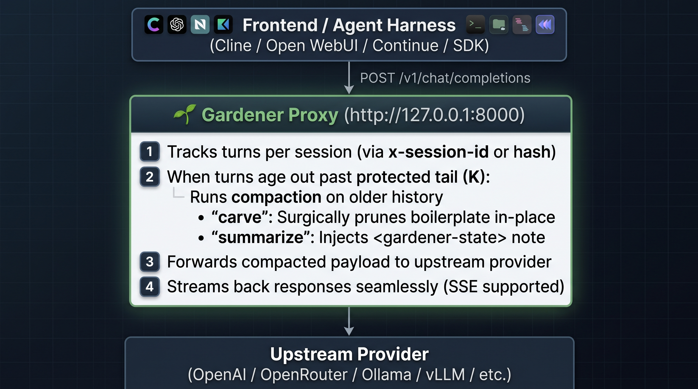

# 🌿 Gardener Proxy

**Turn-based context compaction reverse proxy for LLMs and coding agents**

Gardener is an OpenAI API-compatible reverse proxy that sits transparently between your LLM clients (Open WebUI, LibreChat, Cline, Continue, Cursor, custom agents) and any upstream provider (OpenAI, OpenRouter, Ollama, vLLM, etc.).

Instead of letting conversation context balloon until hitting token limits or triggering monolithic context overflows, Gardener continuously and intelligently prunes older history while keeping the most recent turns untouched.

---

## 💡 Why Gardener?

In long coding and chat sessions, context quickly accumulates noise:

* Multi-page tool outputs, file dumps, and build logs.
* Failed search attempts and discarded exploration paths.
* Boilerplate code that can easily be regenerated.

Traditional agents wait until hitting a token cliff (e.g. 100k+ tokens) and perform a massive, lossy summary pass that suffers from "telephone game" degradation.

**Gardener takes a continuous, turn-based approach:**

* **Rolling Protected Window:** Keeps the last $K$ assistant turns (default `5`) completely untouched and verbatim.
* **Continuous Pruning:** As older turns age out past the protected window every $N$ turns (default `3`), Gardener reduces the aged-out turns before forwarding to upstream.
* **Dual Compaction Strategies:** Choose between surgical in-place editing (`carve`) or unified state summarization (`summarize`).
* **Consistent Model Alignment:** Gardener can mirror the client request's model or use a dedicated fast/local model for compaction.


[Initial test results](https://github.com/pxp888/memento/blob/main/testing.md)

*note - tests above happened with the older state summarizing method, not the newer carve method.*


---

## 🔍 Architecture & How It Works



---

## ✂️ Compaction Strategies

Gardener supports two compaction modes configured via `gardener.strategy`:

### 1. `carve` (Recommended — Surgical In-Place Editing)

The gardener model acts as an editor with tool-calling capabilities (`replace_message_content`, `remove_message`). It inspects the aged-out messages and surgically trims verbose file dumps, large log outputs, and failed searches, while keeping the user's original wording and key code blocks completely intact.

* **Zero telephone game loss:** Original messages remain in their authentic positions.
* **OpenAI API Schema preserved:** Tool messages and role invariants are strictly maintained.

### 2. `summarize` (State Note Replacement)

The older aged-out turns are folded into a structured `<gardener-state>` summary note and injected into or alongside the system prompt, followed by the verbatim protected tail.

---

## 🚀 Getting Started

### 1. Setup & Installation

Clone the repository, create a virtual environment, and install dependencies:

```bash
git clone https://github.com/pxp888/gardener.git
cd gardener
python3 -m venv venv
./venv/bin/pip install -e .
```

### 2. Configuration (`config.yaml`)

Copy `config.example.yaml` to `config.yaml` and configure your upstream:

```yaml
server:
  host: "127.0.0.1"
  port: 8000

upstream:
  base_url: "https://api.openai.com/v1"
  api_key: ""  # Or set via OPENAI_API_KEY environment variable

gardener:
  strategy: "carve"   # "carve" (surgical editing) or "summarize" (state note)
  turns: 3            # Garden every N turns
  protected_turns: 5  # Keep last K assistant turns untouched
  min_tokens_to_garden: 100
  model: ""           # If empty, mirrors the model requested by client
  debug: false        # Set to true to dump before.md and after.md
```

### 3. Running the Proxy

Start the server using the CLI:

```bash
./venv/bin/gardener
```

Or pass CLI arguments directly:

```bash
./venv/bin/gardener --port 8000 --upstream https://api.openai.com/v1 --turns 3 --protected-turns 5
```

### 4. Connect Your Client

Point any OpenAI-compatible client, UI, or SDK to the proxy endpoint:

```bash
export OPENAI_BASE_URL="http://127.0.0.1:8000/v1"
```

---

## ⚙️ Configuration Reference

### CLI Flags & Config Options

| Setting / Flag                  | CLI Option                | Default                     | Description                                                   |
|:------------------------------- |:-------------------------:|:---------------------------:|:------------------------------------------------------------- |
| `server.port`                   | `-p`, `--port`            | `8000`                      | Port the proxy listens on.                                    |
| `server.host`                   | `-H`, `--host`            | `127.0.0.1`                 | Host address to bind to.                                      |
| `upstream.base_url`             | `-u`, `--upstream`        | `https://api.openai.com/v1` | Upstream OpenAI-compatible API base URL.                      |
| `gardener.strategy`             | —                         | `carve`                     | Compaction strategy: `carve` or `summarize`.                  |
| `gardener.model`                | `-m`, `--model`           | `""` (mirror)               | Model used for compaction. If empty, mirrors requested model. |
| `gardener.turns`                | `-n`, `--turns`           | `3`                         | Frequency: garden every $N$ turns.                            |
| `gardener.protected_turns`      | `-k`, `--protected-turns` | `5`                         | Number of recent assistant turns to keep verbatim.            |
| `gardener.min_tokens_to_garden` | —                         | `100`                       | Skip compaction if eligible history is below token threshold. |
| `gardener.debug`                | —                         | `false`                     | Dump `before.md` and `after.md` on each compaction run.       |

### Environment Variables

| Variable                   | Description                                          |
|:-------------------------- |:---------------------------------------------------- |
| `OPENAI_API_KEY`           | Upstream API key if not specified in config.         |
| `OPENAI_BASE_URL`          | Override upstream base URL.                          |
| `GARDENER_HOST`            | Proxy bind host.                                     |
| `GARDENER_PORT`            | Proxy bind port.                                     |
| `GARDENER_TURNS`           | Number of turns between gardening passes.            |
| `GARDENER_PROTECTED_TURNS` | Number of recent assistant turns kept untouched.     |
| `GARDENER_STRATEGY`        | Compaction strategy (`carve` or `summarize`).        |
| `GARDENER_DEBUG`           | Set to `1` or `true` to enable debug markdown dumps. |

---

## 🐛 Debugging Context Compaction

Enable `debug: true` in `config.yaml` or set `GARDENER_DEBUG=1`. On every gardening run, Gardener will write two markdown files to your current working directory:

* **`before.md`**: Complete message history and token breakdown before compaction.
* **`after.md`**: Compacted message history after surgical carving or summarization.

---

## 📝 Customizing Prompts

Persona instructions, preservation priorities, and carving criteria are defined in:

* `gardener/prompt.py`: Contains `CARVER_SYSTEM_PROMPT` and `GARDENER_PROMPT`.

---

## 🧪 Testing

Run test suite with pytest:

```bash
./venv/bin/pytest
```
